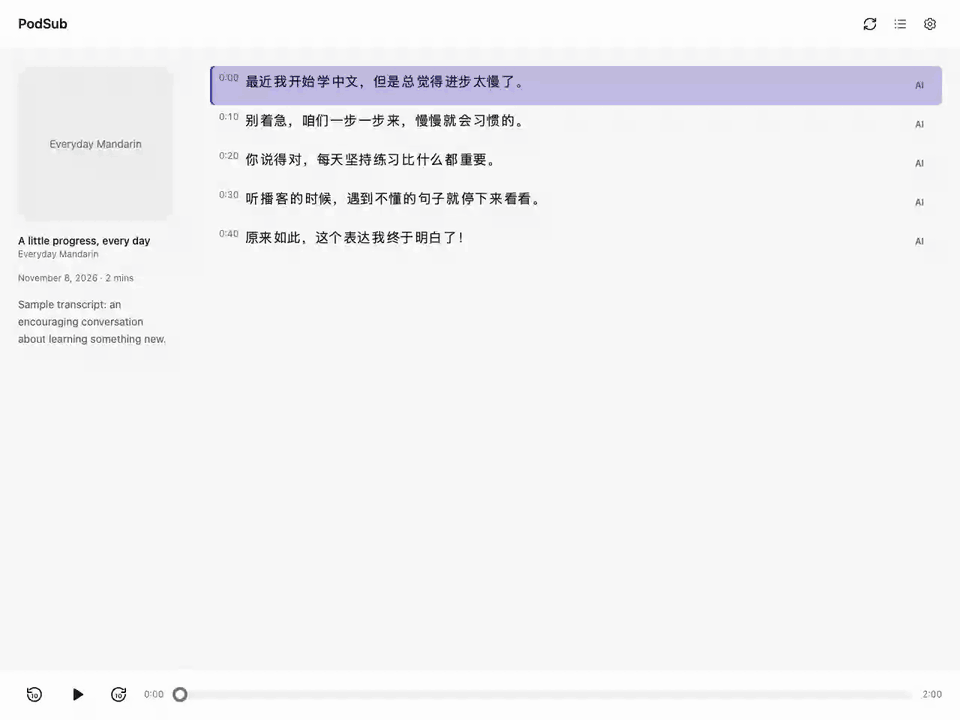
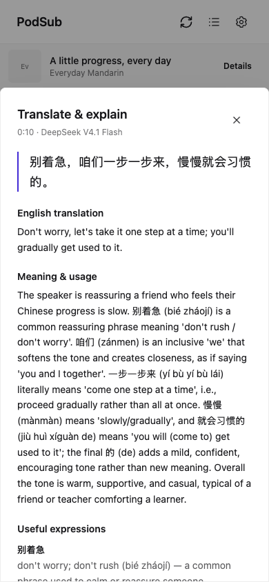

# Transcript AI demo

The recording shows the production UI opening a line explanation, displaying
translation and useful expressions, and changing the explanation model in Settings.
The sample Chinese transcript is demo data; the explanation was generated by a
real OpenRouter request to `deepseek/deepseek-v4.1-flash`. The recording reuses that
server-cached response. No personal library data or API keys are included.

The recording predates the icon-only trigger: the translate button now uses
sparkles, appearing on row hover or keyboard focus on desktop, and staying visible
on touch devices.

The browser walkthrough also verified Escape dismissal, focus returning to the
line's translate button, model preference persistence, and the mobile bottom sheet at
390 × 844 with no horizontal overflow or JavaScript page errors.

